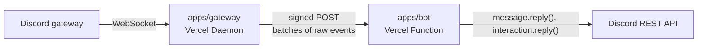

# discord-on-vercel

Run a [discord.js](https://discord.js.org) bot on Vercel.

A Discord bot needs a WebSocket connection to Discord's gateway that never closes, which a Vercel Function can't hold. This template puts that connection in a [Vercel Daemon](https://vercel.com/docs/daemons), an always-on process, and keeps it small: it relays each event to a Vercel Function, where you write normal discord.js code.

```ts
// apps/bot/src/bot.ts
export const client = new Client({ intents: [GatewayIntentBits.Guilds, GatewayIntentBits.GuildMessages] });

client.on(Events.MessageCreate, async (message) => {
  if (message.mentions.users.has(client.user!.id)) await message.reply(`Hi ${message.author}!`);
});
```

## How it works



1. **The gateway daemon** (`apps/gateway`) holds the connection using [`@discordjs/ws`](https://www.npmjs.com/package/@discordjs/ws), the same library discord.js uses. On startup it asks the bot which intents to use and which events it listens to, and forwards only those events.
2. It sends events in **batches**: up to 100 at a time, or whatever has arrived after 10 ms. Under load, one function invocation handles many events; when it's quiet, an event waits at most 10 ms.
3. Functions don't keep the gateway's in-memory cache, so the gateway keeps one for them: each guild's channels, roles, emojis, stickers and the bot's own member. Every change gives the guild a new **revision**. Events carry only the guild's ID and revision. A function instance that doesn't have that revision answers `409` with the snapshots it needs, and the gateway resends the batch with them. Fluid compute reuses instances, so after warm-up almost no batch needs a snapshot.
4. **The relay** (`packages/relay`) loads those snapshots into a real discord.js `Client` and replays each raw packet through discord.js' own handlers. Your listeners get the same `Message`, `Interaction`, `GuildMember` and other objects a connected bot would. `message.guild`, permission checks and old/new values on updates all work, and `reply()` goes to Discord's REST API as usual.

The function responds as soon as your listeners start, and [`waitUntil`](https://vercel.com/docs/functions/functions-api-reference/vercel-functions-package#waituntil) keeps it running until they finish, so a slow handler never holds up the gateway.

## Layout

| Path | What it is | You edit it? |
| --- | --- | --- |
| `apps/bot` | Vercel Functions service (Hono). Your discord.js client, listeners and slash commands. | Yes |
| `apps/gateway` | Vercel Daemon. Holds the gateway connection, caches guild structure, batches events. | Rarely |
| `packages/relay` | Runs a discord.js client without a gateway connection, inside a function. | No |
| `Dockerfile.gateway` | The daemon's image. It sits at the root because the Dockerfile's directory is the build context, and the gateway installs from the workspace lockfile. | No |
| `vercel.json` | One project: the `bot` service plus the `gateway` daemon. | When adding services |

## Setup

You need Node 24, pnpm and [Vercel CLI](https://vercel.com/docs/cli) 64.3 or later.

1. **Create a Discord application** in the [Developer Portal](https://discord.com/developers/applications). Under **Bot**, select **Reset Token** and copy the token.
2. **Create the Vercel project** from the repository root (daemons don't support a subfolder as the project root yet):

   ```sh
   pnpm install
   vercel link
   vercel env add DISCORD_TOKEN production
   ```

3. **Deploy to production.** Daemons only run in production deployments.

   ```sh
   vercel --prod
   ```

4. **Register the slash commands.** The command prints an invite link for your bot.

   ```sh
   vercel env pull          # or put DISCORD_TOKEN in .env.local
   pnpm commands:register
   ```

5. Invite the bot to a server, mention it, and try `/ping` and `/server`.

To check on the gateway, run `vercel daemons ls`, or filter the logs to the daemon with `vercel logs --query 'source:daemon'`. It logs when it connects, which events it forwards, and stats every 10 minutes.

## Writing your bot

`apps/bot/src/bot.ts` is a regular discord.js client. Add intents and listeners as you would in any discord.js project, then deploy. The new deployment restarts the daemon, and it picks up your new intents and listeners. Slash commands live in `apps/bot/src/commands`. Run `pnpm commands:register` after changing their names, descriptions or options.

A few things work differently from a bot running in one long-lived process:

- **Don't call `client.login()`.** The daemon holds the connection, so `login()` does nothing here.
- **Keep state outside memory.** Each event can run on a different function instance. Use a database from the [Vercel Marketplace](https://vercel.com/marketplace) for anything that has to persist.
- **Handle components in `interactionCreate`.** Collectors and `awaitMessageComponent` wait for later events on the same instance, so use the button or select menu `customId` instead.
- **Reply to interactions within 3 seconds.** The relay adds a network hop, and a cold start may add more. For slower work, call `interaction.deferReply()` first. `/ping` reports how long an interaction took to reach your function.
- **Gateway-only features aren't available in functions:**
  - Setting presence at runtime. Set `presence` in the client options instead; the gateway identifies with it.
  - Fetching all guild members with `guild.members.fetch()`. Use `guild.members.list()` or fetch members by ID instead.
  - Voice connections.
- **What's cached:** guild structure (channels, roles, emojis, stickers and the bot's member), plus the thread an event happened in. Messages, other members, presences and voice states aren't. Events about anything uncached arrive as [partials](https://discordjs.guide/popular-topics/partials.html), so `fetch()` what you need. For example, `messageDelete` gets a partial message.
- **Ordering is best effort.** Events within a batch replay in order, but concurrent batches can land on different instances.

Only events your client has listeners for are forwarded. A `messageCreate` listener means every message in every server the bot is in reaches your function, batched.

## Local development

Use a **separate Discord application** for development. Two gateways connected with the same token both receive every event, so production and your laptop would both reply.

```sh
cp .env.example .env.local   # add your development bot's DISCORD_TOKEN
pnpm dev                     # bot on http://localhost:3000, gateway relaying to it
DISCORD_GUILD_ID=<your test server> pnpm commands:register
```

The local gateway always relays to `localhost:3000` (see `apps/gateway/.env.development`). To run the daemon exactly as Vercel does, use its container:

```sh
docker build -f Dockerfile.gateway -t discord-gateway .
docker run -e DISCORD_TOKEN="$DISCORD_TOKEN" -e DISCORD_RELAY_URL=http://host.docker.internal:3000/api/gateway discord-gateway
```

`pnpm test` runs the test suites, including an end-to-end test against a fake Discord: gateway process → bot service → discord.js → REST. `pnpm bench` measures throughput and CPU per event (see below).

## Configuration

| Variable | Used by | Default |
| --- | --- | --- |
| `DISCORD_TOKEN` | both | Required. |
| `DISCORD_RELAY_SECRET` | both | A key derived from `DISCORD_TOKEN`. Set it to sign relay requests with a separate secret. |
| `DISCORD_RELAY_URL` | gateway | `https://$VERCEL_PROJECT_PRODUCTION_URL/api/gateway` |
| `DISCORD_SHARD_COUNT` | gateway | Discord's recommended count. All shards run in one instance. |
| `GATEWAY_BATCH_SIZE` | gateway | `100` events per invocation at most. |
| `GATEWAY_BATCH_LINGER_MS` | gateway | `10`. How long an event can wait for a batch to fill. |
| `GATEWAY_DEBUG` | gateway | Off. `1` logs connection details. |
| `DISCORD_GUILD_ID` | `commands:register` | Unset, which registers commands globally. |

The gateway signs every request with HMAC-SHA256, and the relay rejects any request that isn't signed or is more than 5 minutes old. If Deployment Protection covers your production domain, enable [Protection Bypass for Automation](https://vercel.com/docs/deployment-protection/methods-to-bypass-deployment-protection/protection-bypass-automation); the gateway sends the bypass header automatically.

## Performance and cost

`pnpm bench` runs a fake Discord, the real gateway process and the real bot service on your machine, and sends `MESSAGE_CREATE` traffic across 100 guilds. On an Apple Silicon laptop:

| Load | Throughput | Latency (p50 / p99) | Events per invocation | Gateway CPU per event | Function CPU per event |
| --- | --- | --- | --- | --- | --- |
| 1,000/s | 1,000/s | 13 ms / 15 ms | 11 | 156 µs | 118 µs |
| 10,000/s | 10,000/s | 2 ms / 3 ms | 100 | 23 µs | 22 µs |
| As fast as possible | ~97,000/s | queueing | 100 | 13 µs | 13 µs |
| 1,000/s, batching off | 1,000/s | 1 ms / 4 ms | 1 | 256 µs | 143 µs |

The cost per event is mostly the cost per request, so it falls as batches fill. Idle, both processes use about 0.2% of a core. These numbers come from loopback without TLS, on a laptop that moves lightly loaded processes to slower cores, so treat them as orders of magnitude.

At iad1 rates, the relay's own overhead for a million events at 10,000/s comes to about $0.006 in invocations (10,000 of them) and $0.001 in Active CPU. Your handlers' own CPU and provisioned memory come on top. Without batching, the same million events would cost $0.60 in invocations alone.

## Operating notes

- **Run one instance.** Each daemon instance opens its own gateway connection, so `"instances": { "iad1": 2 }` would deliver every event twice. One instance runs all shards.
- **Deploys swap the connection.** On each production deploy, Vercel starts the new daemon and stops the old one. The old one disconnects as soon as it receives `SIGTERM`, but a few events around the swap can arrive twice or not at all.
- **Delivery is at-least-once.** The gateway retries when the platform fails, such as a 502, 503 or 504, or a network error. It doesn't retry when your code fails, and each function instance skips events it has already handled.
- **Size `maxGuilds` to your working set.** Each function instance keeps up to 5,000 guilds loaded, about 40 KB each for a guild with 25 channels and 15 roles. If more guilds than that are active, batches keep asking for snapshots and throughput drops about 10x. Raise it with `createRelayHandler(client, { maxGuilds })`.
- **REST rate limits are per bot.** Each function instance tracks Discord's rate limits on its own. A busy bot with many instances will see more 429 responses, which discord.js retries. At that scale, point `rest.api` in your client options at a shared REST proxy.
- **Quotas.** On Hobby, daemons get 5 Active CPU-hours a month, counted only while the process is working. Going by the numbers above, that covers somewhere around a hundred million events a month. See [Daemons limits](https://vercel.com/docs/daemons/limits).
- **Previews.** Daemons don't run in preview deployments, so the gateway always relays to production. Test changes locally.
